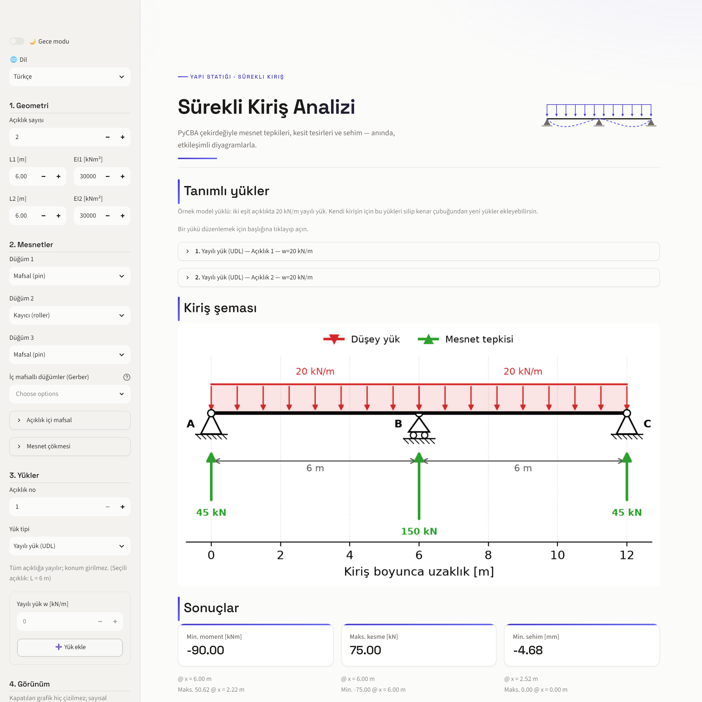
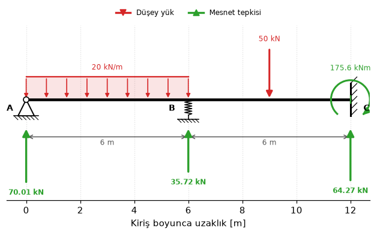

# pyCBA-UI

Sürekli kirişleri tarayıcıda çözen bir arayüz. Açıklıkları, mesnetleri ve yükleri
forma giriyorsun; mesnet tepkileri, kesme ve moment diyagramları ve sehim eğrisi
anında çıkıyor. Hesabı [PyCBA](https://github.com/ccaprani/pycba) yapıyor, bu
depo onun üstüne oturan sunum katmanı.

**Canlı sürüm:** https://BURAYA-ADRESI-YAZ.streamlit.app



## Neden yazdım

PyCBA'yı kullanmak için Python bilmek gerekiyor. `L`, `EI`, `supports` ve `LM`
listelerini elle kurup analiz nesnesini çağırıyorsun. Yapı statiği dersini yeni
alan biri için bu, çözmek istediği problemden daha büyük bir engel. Arayüz o
engeli kaldırıyor; hesaba karışmıyor.

## Neler var

- Çok açıklıklı sürekli kiriş, açıklık başına ayrı uzunluk ve EI.
- Mesnetler: mafsal, kayıcı, ankastre, serbest ve elastik yay. Yayın katsayısını
  kN/m olarak giriyorsun, düğüm çöküyor ve tepki k·δ kadar oluyor.
- Yükler: yayılı, tekil, kısmi yayılı, moment, trapez. Kiriş eksenine paralel
  tekil ve yayılı yükler de var, normal kuvvet diyagramıyla birlikte.
- Gerber kirişleri. Mafsalı mesnet hizasına koyabildiğin gibi açıklığın ortasına
  da koyabiliyorsun; açıklık orada otomatik bölünüyor, yük numaralandırman
  değişmiyor.
- Mesnet çökmesi, milimetre cinsinden.
- Kiriş şeması: mesnet glifleri, yük okları, tepki okları, düğüm harfleri.
- Diyagramlar Plotly ile çiziliyor, ekstremler konumlarıyla işaretleniyor,
  veriler CSV olarak iniyor.
- Türkçe/İngilizce arayüz ve gece modu.



## Yerelde çalıştırma

```bash
git clone https://github.com/halilacc/pyCBA-UI
cd pyCBA-UI
python -m venv .venv
.venv\Scripts\pip install -r requirements.txt
.venv\Scripts\python -m streamlit run app.py
```

Linux ya da macOS'ta `.venv\Scripts\` yerine `.venv/bin/` yazacaksın. Geliştirme
Python 3.14 ile yapılıyor, dağıtımdaki sürüm 3.13.

## Sonuçlara ne kadar güvenebilirsin

Hesap mantığı (`core/`) arayüzden tamamen ayrı ve testli. Testlerdeki her vaka
elle ya da kapalı formülle doğrulanabiliyor: iki eşit açıklıkta tam yayılı yük
için M_B = −wL²/8, konsol ucundaki yayda δ = (wL⁴/8EI)/(1 + kL³/3EI), Gerber
düzenlerinde izostatik denge gibi. PyCBA'nın çıktısını "olduğu gibi" dondurup
test diye saymadım. Kütüphane bir gün değişirse bunu fark etmek istiyorum.

```bash
.venv\Scripts\python -m pytest -q                 # 78 test
.venv\Scripts\python ornek1_surekli_kiris.py      # referans problem, elle doğrulanmış
```

Yine de şunu açık yazayım: bu bir kontrol ve öğrenme aracı, tasarım yazılımı
değil. Bir projeye koymadan önce sonucu kendi hesabınla karşılaştır.

## Bilinen sınırlar

Bunlar eksik değil, kararlar. Gizlemek yerine yazıyorum:

- Yük düzenlemesi ve zarf diyagramı yok. Yazmıştım, sonra kaldırdım. Zarfın
  eksene kenetlenmesi (PyCBA'nın çizim geleneği) bandı okunmaz hale getiriyordu,
  yarım bir özellik yayınlamaktansa çıkarmayı seçtim. Ölçümler ve gerekçe
  `pyCBA-UI-Planı.md` dosyasının sonunda duruyor.
- Eksenel çözücü, kesit alanını (EA) bütün açıklıklarda eşit varsayıyor. Tek
  yatay tutulu mesnet varken sonuç kesin; birden çoksa yatay tepkilerin
  paylaşımı yaklaşık kalıyor. Uygulama bu durumda uyarı gösteriyor.
- Yay mesnet yalnız düşey. PyCBA dönme yayını da destekliyor, arayüz sormuyor.
- Kesit tahkiki, donatı hesabı, sehim sınırı kontrolü yok. Çıktı kesit tesiri;
  onunla ne yapacağına sen karar veriyorsun.

## Mimari

`core/` Streamlit'i hiç import etmez. Model ve doğrulama `model.py`'de, çözüm
`solver.py`'de, eksenel çözüm `axial.py`'de, kullanıcıya gösterilen hata
mesajları `mesajlar.py`'de. `app.py` yalnızca sunum yapar. Arayüzü bir gün
Gradio ya da Flask'a taşımak istersem çekirdeğe dokunmam gerekmesin diye böyle
kuruldu. Arayüz metinleri de koddan ayrı: `ui_dil.py` iki dilli katalog.

Katkı ya da hata bildirimi için issue açabilirsin.

## Lisans

AGPL-3.0. Hesap çekirdeği PyCBA da AGPL-3.0 ve telifi Colin Caprani'ye ait;
ayrıntı `NOTICE` dosyasında. Bu kodu ağ üzerinden bir hizmet olarak sunarsan
kaynağını kullanıcılara açmak zorundasın, uygulamanın içindeki kaynak kod
bağlantısı bunun için var.

## In English

A browser interface for continuous beam analysis, built on top of PyCBA. You
enter spans, supports and loads in a form and get support reactions, shear and
bending moment diagrams and the deflected shape. It handles multi-span beams,
Gerber hinges (at a support or inside a span), support settlement, elastic
spring supports, axial loads and CSV export. The interface is available in
Turkish and English.

The analysis code in `core/` has no Streamlit dependency and is covered by 78
tests, each verified against a hand or closed-form solution rather than frozen
PyCBA output. Treat it as a study and checking tool, not design software.
