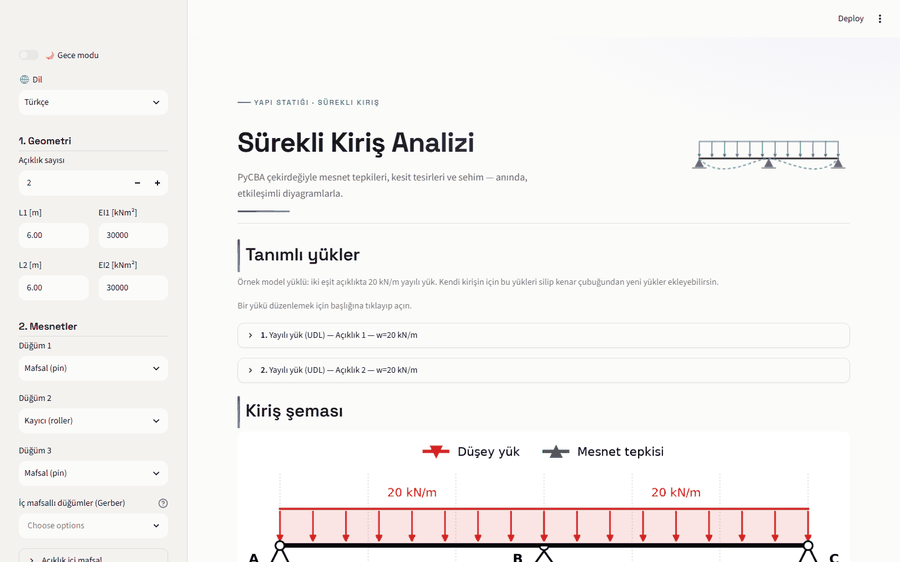

# pyCBA-UI

[](https://pycba-ui-yap1.streamlit.app)
[](https://www.python.org)
[](https://github.com/halilacc/pyCBA-UI/actions/workflows/testler.yml)
[](https://ccaprani.github.io/pycba)
[](LICENSE)

Sürekli kirişleri tarayıcıda çözen bir arayüz. Açıklıkları, mesnetleri ve yükleri
forma giriyorsun; mesnet tepkileri, kesme ve moment diyagramları ve sehim eğrisi
anında çıkıyor. Hesabı [PyCBA](https://github.com/ccaprani/pycba) yapıyor, bu
depo onun üstüne oturan sunum katmanı.

**Canlı sürüm:** https://pycba-ui-yap1.streamlit.app
*(Streamlit Community Cloud, bir gün kadar ziyaret edilmeyen uygulamayı uyutuyor.
Uyku ekranı çıkarsa uyandırma düğmesine bas — açılması ~ 1 dakika kadar sürer.)*




## Neden yazdım

PyCBA'yı kullanmak için Python bilmek gerekiyor. `L`, `EI`, `supports` ve `LM`
listelerini elle kurup analiz nesnesini çağırıyorsun. Python bilmeyen biri için
bu, çözmek istediği problemden daha büyük bir engel. Arayüz o engeli kaldırıyor;
hesaba karışmıyor.

Bunu açıkça yazayım: ben inşaat mühendisliği öğrencisiyim, yazılımcı değilim.
Arayüzün kodu yapay zekâ yardımıyla yazıldı. Neyin nasıl çalışması gerektiğine
mühendis olarak ben karar verdim — hangi girdiler sorulacak, hangi işaret
kabulü kullanılacak, sonuç nasıl görünecek — kod o tarife göre adım adım
çıktı. Hesabın kendisi bana ait değil zaten; onu PyCBA yapıyor.

## Neler var

- Çok açıklıklı sürekli kiriş, açıklık başına ayrı uzunluk ve EI.
- Mesnetler: mafsal, kayıcı, ankastre, serbest ve elastik yay. Yayın katsayısını
  kN/m olarak giriyorsun, düğüm çöküyor ve tepki k·δ kadar oluyor.
- Yükler: yayılı, tekil, kısmi yayılı, moment, trapez. Kiriş eksenine paralel
  tekil ve yayılı yükler de var, normal kuvvet diyagramıyla birlikte.
- Gerber kirişleri. Mafsalı mesnet hizasına koyabildiğin gibi açıklığın ortasına
  da koyabiliyorsun; açıklık orada otomatik bölünüyor, yük numaralandırman
  değişmiyor.
- Mesnet çökmesi, milimetre cinsinden.
- Eklediğin yükler listeleniyor; satırı açıp açıklığını ve değerlerini
  değiştirebiliyorsun, yanlış girilen yükü silip yeniden eklemek gerekmiyor.
- Kiriş şeması: mesnet glifleri, yük okları, tepki okları, düğüm harfleri.
- Diyagramlar Plotly ile çiziliyor, ekstremler konumlarıyla işaretleniyor,
  veriler CSV olarak iniyor.
- Türkçe/İngilizce arayüz ve gece modu.


## Yerelde çalıştırma

```bash
git clone https://github.com/halilacc/pyCBA-UI
cd pyCBA-UI
python -m venv .venv
.venv\Scripts\pip install -r requirements.txt
.venv\Scripts\python -m streamlit run app.py
```

Linux ya da macOS'ta `.venv\Scripts\` yerine `.venv/bin/` yazacaksın. Geliştirme
Python 3.14 ile yapılıyor, dağıtımdaki sürüm 3.13.

## Sonuçlara ne kadar güvenebilirsin

Hesap mantığı (`core/`) arayüzden tamamen ayrı ve testli. Testlerdeki her vaka
elle ya da kapalı formülle doğrulanabiliyor: iki eşit açıklıkta tam yayılı yük
için M_B = −wL²/8, konsol ucundaki yayda δ = (wL⁴/8EI)/(1 + kL³/3EI), Gerber
düzenlerinde izostatik denge gibi. PyCBA'nın çıktısını "olduğu gibi" dondurup
test diye saymadım. Kütüphane bir gün değişirse bunu fark etmek istiyorum.

Kodu yapay zekâ yardımıyla yazdırmış olmam bu bölümü daha da önemli kılıyor:
koda bakıp doğruluğuna karar veremem, sonuca bakıp karar veririm. O yüzden her
testin karşılığı elle çözülebilen bir problem. Referans vaka iki eşit açıklıkta
20 kN/m yayılı yük: M_B = −90 kNm, tepkiler 45/150/45 kN — el hesabıyla aynı.

```bash
.venv\Scripts\python -m pytest -q                 # çekirdek + dil + arayüz testleri
.venv\Scripts\python ornek1_surekli_kiris.py      # referans problem, elle doğrulanmış
```

Testler `main`'e her itmede ve her pull request'te GitHub Actions'ta 3.13 ve
3.14 ile çalışıyor (`.github/workflows/testler.yml`).

Yine de şunu açık yazayım: bu bir kontrol ve öğrenme aracı, tasarım yazılımı
değil. Bir projeye koymadan önce sonucu kendi hesabınla karşılaştır.

## Bilinen sınırlar

Bunlar eksik değil, kararlar.

- Hareketli yük düzenlemesi (şaşırtmalı yükleme) ve ondan çıkan zarf diyagramı
  yok — yani yüklediğin durumu çözüyor, en elverişsiz yükleme durumunu kendisi
  aramıyor. Zarfı yazmıştım, sonra kaldırdım. Zarfın
  eksene kenetlenmesi (PyCBA'nın çizim geleneği) bandı okunmaz hale getiriyordu,
  yarım bir özellik yayınlamaktansa çıkarmayı seçtim.
- Eksenel çözücü, kesit alanını (EA) bütün açıklıklarda eşit varsayıyor. Tek
  yatay tutulu mesnet varken sonuç kesin; birden çoksa yatay tepkilerin
  paylaşımı yaklaşık kalıyor. Uygulama bu durumda uyarı gösteriyor.
- Yay mesnet yalnız düşey. PyCBA dönme yayını da destekliyor, arayüz sormuyor.
- Kesit tahkiki, donatı hesabı, sehim sınırı kontrolü yok. Çıktı kesit tesiri;
  onunla ne yapacağına sen karar veriyorsun.
- Diyagramlar açıklık başına 1000 eşit aralıklı istasyonda hesaplanıyor ve
  ızgara yük konumlarına göre kaydırılmıyor. Tekil yükün ya da momentin tam
  altındaki tepe değer bir istasyona denk gelmezse ekstrem binde bir mertebesinde
  düşük okunabilir; kartlardaki değer ve konumu bu ızgaradan gelir. El hesabıyla
  son hanesine kadar aynı çıkmazsa sebebi bu olabilir.

## Mimari

`core/` Streamlit'i hiç import etmez. Model ve doğrulama `model.py`'de, çözüm
`solver.py`'de, eksenel çözüm `axial.py`'de, kullanıcıya gösterilen hata
mesajları `mesajlar.py`'de. `app.py` yalnızca sunum yapar. Arayüzü bir gün
Gradio ya da Flask'a taşımak istersem çekirdeğe dokunmam gerekmesin diye böyle
kuruldu. Arayüz metinleri de koddan ayrı: `ui_dil.py` iki dilli katalog.

Katkı ya da hata bildirimi için issue açabilirsin.

## Lisans

AGPL-3.0. Hesap çekirdeği PyCBA da AGPL-3.0 ve telifi Colin Caprani'ye ait;
ayrıntı `NOTICE` dosyasında. Bu kodu ağ üzerinden bir hizmet olarak sunarsan
kaynağını kullanıcılara açmak zorundasın, uygulamanın içindeki kaynak kod
bağlantısı bunun için var.

## In English


A browser interface for continuous beam analysis, built on top of PyCBA. You
enter spans, supports and loads in a form and get support reactions, shear and
bending moment diagrams and the deflected shape. It handles multi-span beams,
Gerber hinges (at a support or inside a span), support settlement, elastic
spring supports, axial loads, an editable load list and CSV export. The
interface is available in Turkish and English.

The analysis code in `core/` has no Streamlit dependency and is covered by tests
(run on every push to `main` and every pull request via GitHub Actions), each
verified against a hand or
closed-form solution rather than frozen PyCBA output. Treat it as a study and
checking tool, not design software.

To be open about it: I'm a civil engineering student, not a programmer, and the
interface code was written with AI assistance. I decided as an engineer what the
tool had to do and checked the results by hand; the analysis itself is PyCBA's.
That is also why every test corresponds to a problem solvable on paper.
